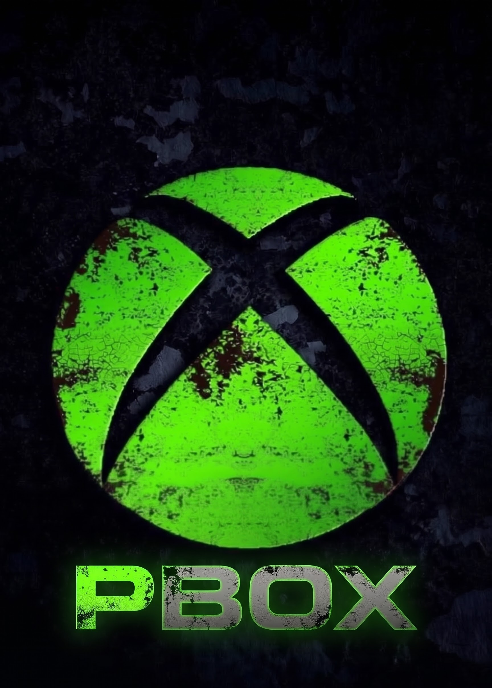

<p align="center">
  
</p>

<h1 align="center">PBOX</h1>
<p align="center"><strong>Independent PS4 Cloud Gaming Client</strong></p>
<p align="center">A lightweight native dashboard and streaming client for homebrew-enabled PlayStation 4 systems.</p>

<p align="center">
  <a href="https://github.com/noan511ee-dot/Xbox-ps4-/releases/latest"></a>
  <a href="https://github.com/noan511ee-dot/Xbox-ps4-/actions/workflows/build-ps4-pkg.yml"></a>
  
  
  <a href="LICENSE"></a>
</p>

## Overview

PBOX is an independent PS4 cloud gaming client focused on a responsive native interface, reliable streaming, and practical controller support. It presents an Xbox-inspired Games dashboard with featured artwork, game details, a Play action, library browsing, console navigation, settings, and streaming diagnostics.

PBOX is not an emulator. It does not emulate Xbox or PlayStation hardware, copy games, bypass cloud-service authentication, or distribute copyrighted game content. The client requests a streaming session from a supported cloud service and forwards the resulting video, audio, and input data to the PS4.

The project is designed for a homebrew-enabled PS4 environment. A compatible PS4 firmware, a compatible homebrew environment such as GoldHEN, a supported cloud account, and a suitable streaming subscription may be required. Service availability, server region, account permissions, and network quality are outside the control of this repository.

## Main Features

### Native Games Dashboard

- Xbox-inspired Games / Media navigation chrome.
- Featured game artwork and a large focused-game card.
- Play action, game details, publisher and category information.
- Library rows and game entries populated from the connected catalog.
- Console navigation and settings screens using the same native renderer.
- Lightweight drawing with no HTML, JavaScript, browser runtime, or expensive blur pipeline.
- PBOX branding, custom artwork, intro animation, and PS4 package assets.

### Streaming and Network Handling

- H.264 cloud video streaming with PS4 display output.
- Hardware-preferred video decoding when the platform exposes a usable decoder.
- Software decoding fallback when hardware decoding is unavailable.
- Asynchronous presentation and frame pacing improvements.
- Bounded video and audio queues to prevent old network bursts from creating permanent latency.
- RTP loss tracking, NACK recovery, RTCP reporting, jitter handling, and keyframe requests.
- Automatic reconnect behavior for short-lived connection failures.
- Adaptive resolution behavior that can request a lower stream tier when sustained degradation is detected.
- Bitrate limits and automatic bitrate behavior for different network conditions.
- Runtime statistics including FPS, bitrate, RTT, packet loss, decode time, resolution, and dropped frames.

### Input and Responsiveness

- DualShock 4 / supported controller input.
- Native PS4 keyboard and mouse detection and recovery after disconnects.
- Keyboard and mouse mappings with per-game settings support.
- Coalesced mouse motion so an old input backlog does not build up during network bursts.
- Newest mouse-button state is preserved for responsive aiming and interaction.
- Controller input is sent through the existing stream protocol without changing the service protocol.
- Western confirmation is the default: Cross/X confirms and Circle/O is the alternate button. The setting can be changed explicitly instead of being changed automatically.

### Arabic and Localization

- English and Arabic UI catalogs.
- Arabic font resources and dependency-free Arabic glyph shaping for the native renderer.
- Arabic settings, navigation, stream status, resolution, input, and connection labels.
- Localization is designed to avoid reversing Arabic glyph order or silently changing controller mappings.
- More text can be translated through the existing `src/ui/i18n` catalogs.

### Stability and Resource Management

- Exception guards around critical media callbacks and worker loops.
- Cleanup of video, audio, input, presentation, and text-request queues when a stream ends.
- Bounded pending keyboard and mouse input queues.
- Audio queue trimming that favors the live edge when old packets accumulate.
- Reconnect and keyframe recovery rather than exiting the whole application after a recoverable stream error.
- Watchdog logging for a stream loop that stops making progress.
- Explicit separation between UI, media, input, and network responsibilities.

## Quality and 4K Clarification

PBOX can request the highest stream tier made available by the cloud service and account. The current project supports 720p, 1080p, and an experimental Best / 1440p path where the server and account allow it.

A local upscaler can improve the appearance of a lower-resolution stream on a 4K display. This is not the same as receiving a native 4K cloud stream. PBOX does not claim to unlock a true 4K stream when the cloud provider does not send one.

Actual FPS, latency, packet loss, resolution, and image quality depend on the cloud server, account, region, PS4 output mode, Wi-Fi or mobile hotspot quality, signal strength, congestion, and route to the service. No application can guarantee a fixed ping or eliminate every network-related frame drop.

## 4G and 5G Guidance

PBOX does not require a special 4G or 5G mode. It adapts through the existing stream controls and queue limits. For a more stable session:

- Use a stable 5G connection when available; stable 4G can be better than unstable 5G.
- Keep the phone or hotspot close to the PS4 and avoid downloads or backups during play.
- Start with 720p or automatic bitrate on a changing connection.
- Monitor RTT, loss, bitrate, FPS, and dropped frames in the stream statistics.
- Select a region with the lowest measured latency when the account and service permit it.

## Repository Layout

- `src/app/` — application lifecycle, streaming workers, settings, reconnect logic, and stream presentation.
- `src/stream/` — WebRTC session handling, callbacks, RTP reporting, input channels, and recovery.
- `src/media/` — video decoding, audio decoding, audio queues, and PS4 media output.
- `src/input/` — DualShock, USB controller, keyboard, mouse, key mapping, and button mapping.
- `src/ui/` — native canvas UI, dashboard, library, settings, fonts, localization, image cache, and branding.
- `assets/` — PBOX logos, fonts, and visual resources.
- `ps4/` — PS4 package metadata and install assets.
- `.github/workflows/build-ps4-pkg.yml` — GitHub Actions PS4 PKG build workflow.
- `ps5/PBOX-PS5-STATUS.md` — separate PS5 development notes; this is not a ready PS5 PKG.

## Building a PS4 PKG

The repository provides a GitHub Actions workflow using the OpenOrbis toolchain. From GitHub on a mobile device:

1. Open the **Actions** tab.
2. Select **Build PBOX PS4 PKG**.
3. Choose **Run workflow**.
4. Enter a version such as `1.7.8`.
5. Wait for the build to finish.
6. Download the PKG artifact or attach it to a Release.
7. Verify the accompanying SHA256 file before installing.

A local build requires CMake, Ninja, Clang/LLVM, Python, and a compatible OpenOrbis PS4 toolchain:

```bash
git clone --recursive https://github.com/noan511ee-dot/Xbox-ps4-.git
cd Xbox-ps4-
tools/ps4/fetch-toolchain.sh
cmake -S . -B build-ps4 -G Ninja \
  -DCMAKE_BUILD_TYPE=Release \
  -DCMAKE_TOOLCHAIN_FILE=cmake/ps4.toolchain.cmake
ninja -C build-ps4
tools/ps4/package.sh build-ps4
```

## Releases

Every release should include a clear version number, English release notes, a PS4 PKG, a SHA256 checksum, and a successful GitHub Actions build. Release notes should describe only features and fixes that are actually present in the code.

The latest published release is available on the [PBOX Releases page](https://github.com/noan511ee-dot/Xbox-ps4-/releases).

## Compatibility and Safety Notes

This is an experimental PS4 homebrew client. The same PKG is not guaranteed to work on every PS4 firmware or every GoldHEN version. Compatibility depends on the firmware, system modules, OpenOrbis interfaces, network service, and account access. Test on the target PS4 before relying on the application.

Do not publish account tokens, `account.json`, authentication cookies, private logs, or personal information in Issues or commits. Keep backups of application settings before installing experimental updates.

## Project Status

PBOX is under active development. The PS4 build and release workflow are operational, while some capabilities remain dependent on cloud-service behavior or platform support. In particular, true native 4K cloud streaming, guaranteed fixed ping, guaranteed fixed FPS, and a ready-to-install PS5 PKG are not promised by this repository.

## License and Trademark Notice

PBOX is licensed under GPL-3.0-or-later. PBOX is an unofficial independent project and is not affiliated with Microsoft, Xbox, Xbox Cloud Gaming, Sony Interactive Entertainment, or PlayStation. Xbox, Xbox Cloud Gaming, Game Pass, PlayStation, and PS4 are trademarks of their respective owners.
