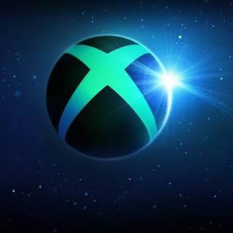

<p align="center">
  
</p>

<h1 align="center">SBOX</h1>
<p align="center"><strong>Cloud gaming client for PlayStation 4</strong></p>
<p align="center">A clean, community-built interface for streaming Xbox Cloud Gaming on a homebrew-enabled PS4.</p>

<p align="center">
  <a href="https://github.com/noan511ee-dot/Xbox/releases/latest"></a>
  <a href="https://github.com/noan511ee-dot/Xbox/actions/workflows/build-ps4-pkg.yml"></a>
  
  
  <a href="LICENSE"></a>
</p>

## ما هو SBOX؟

SBOX هو عميل ألعاب سحابية مخصص لجهاز PlayStation 4 معدل. يعرض مكتبة الألعاب، يطلب جلسة البث، ويرسل تحكم DualShock 4 أو لوحة المفاتيح والماوس إلى الجلسة السحابية. المشروع **ليس محاكيًا** ولا ينسخ ألعاب Xbox أو PlayStation، ولا يوزّع محتوى الألعاب.

يتطلب استخدام SBOX حساب Microsoft وخطة Game Pass تتضمن اللعب السحابي، كما يتطلب جهاز PS4 متوافقًا مع بيئة homebrew وGoldHEN. توفر الخدمة وجودة الاتصال يعتمدان على البلد وشبكة الإنترنت ومسار الخادم.

## أبرز المميزات

- واجهة SBOX جديدة داكنة مع هوية بصرية مستقلة وبطاقات إعدادات واضحة.
- بث H.264 مع عرض غير متزامن على PS4 لتقليل انتظار الصورة.
- ضبط تلقائي للتعامل مع RTT وفقدان الحزم واهتزاز الشبكة.
- NACK وJitter Buffer وRTCP لاستعادة الحزم قدر الإمكان عند تذبذب الشبكة.
- إعادة اتصال تلقائية بعد الانقطاعات القصيرة.
- إعدادات للدقة والـ bitrate وفك ترميز الفيديو والصوت.
- دعم USB DualShock 4، ولوحة المفاتيح والماوس عبر واجهات PS4 الأصلية.
- شاشة إحصائيات تعرض FPS والـ bitrate والكمون وفقدان الحزم والإطارات المسقطة.
- WebUI للتحكم عن بعد وتعديل إعدادات البث وإعادة تعيين أزرار التحكم.
- حفظ الإعدادات وبيانات تسجيل الدخول خارج ملفات التطبيق حتى لا تضيع عادةً عند التحديث.

## آخر إصدار: SBOX v1.6.7

يتضمن الإصدار الأخير:

- إعادة تصميم شاشة الإعدادات بأسلوب Control Centre مع أقسام وفواصل وألوان SBOX.
- إبراز إعدادات الأداء والإدخال للوصول إليها باليد أو بالماوس والكيبورد.
- تقليل تراكم الإطارات القديمة من 90 إلى 72 إطارًا لتقليل التقطيع بعد تذبذب 4G أو 5G.
- خفض حد إعادة مزامنة الفيديو على PS4 من 250ms إلى 220ms.
- الحفاظ على العرض غير المتزامن وNACK وRTCP وإعادة الاتصال والتشخيص.

## التحميل والتثبيت على PS4

1. افتح [صفحة SBOX v1.6.7](https://github.com/noan511ee-dot/Xbox/releases/tag/v1.6.7).
2. حمّل ملف `SBOX-PS4-v1.6.7.pkg` وملف `SBOX-PS4-v1.6.7.pkg.sha256`.
3. انسخ ملف PKG إلى جذر USB مهيأ بنظام exFAT أو FAT32.
4. أدخل USB في PS4.
5. من GoldHEN افتح Package Installer وثبّت الحزمة فوق النسخة السابقة.
6. لا تحذف بيانات التطبيق قبل التحديث؛ تثبيت الحزمة فوق النسخة السابقة يحافظ على البيانات والإعدادات عادةً.

[تحميل PKG مباشر](https://github.com/noan511ee-dot/Xbox/releases/download/v1.6.7/SBOX-PS4-v1.6.7.pkg) · [صفحة جميع الإصدارات](https://github.com/noan511ee-dot/Xbox/releases)

## شبكة 4G و5G

لا يحتاج SBOX إلى وضع خاص باسم 4G أو 5G. اتصل بالـPS4 من نقطة اتصال الهاتف أو من الراوتر، وسيحاول التطبيق التكيف مع سرعة الاتصال. للحصول على أفضل نتيجة:

- استخدم 5G عندما تكون الإشارة مستقرة، وإلا فـ4G ثابتة أفضل من 5G متذبذبة.
- قرّب الهاتف من مكان اللعب وأوقف التنزيلات والنسخ الاحتياطي أثناء اللعب.
- ابدأ بدقة 720p أو bitrate تلقائي إذا كان الاتصال غير مستقر.
- راقب FPS والـ RTT وفقدان الحزم من شاشة الإحصائيات.

## التوافق

هذه حزمة اختبارية لـPS4. لا يوجد ضمان أن نفس PKG سيعمل على كل Firmware من 9.00 إلى 14.00؛ التوافق يعتمد على GoldHEN وإصدار النظام وواجهات OpenOrbis المستخدمة. اختبر الحزمة على جهازك قبل الاعتماد عليها، ولا تحدّث Firmware الجهاز فقط من أجل هذا المشروع.

## سياسة الإصدارات

كل إصدار جديد يجب أن يحتوي على رقم نسخة واضح، وقائمة بالمميزات أو الإصلاحات الفعلية، وملف PKG، وSHA256، ونتيجة GitHub Actions. الإصدارات المستقبلية يجب أن تضيف مميزاتها في [CHANGELOG.md](CHANGELOG.md) وفي ملاحظات Release، لا أن تغيّر الرقم فقط.

## البناء عبر GitHub Actions

يوجد Workflow جاهز في `.github/workflows/build-ps4-pkg.yml` ويستخدم OpenOrbis Toolchain:

1. افتح تبويب **Actions** في GitHub.
2. اختر **Build SBOX PS4 PKG**.
3. اضغط **Run workflow**.
4. أدخل رقم النسخة مثل `1.6.8`.
5. بعد النجاح حمّل Artifact، أو أنشئ Tag مثل `v1.6.8` لإصدار Release.

للبناء المحلي، يلزم CMake 3.20 أو أحدث وNinja وClang/LLVM وPython وOpenOrbis Toolchain:

```bash
git clone --recursive https://github.com/noan511ee-dot/Xbox.git
cd Xbox
tools/ps4/fetch-toolchain.sh
cmake -S . -B build-ps4 -G Ninja \
  -DCMAKE_BUILD_TYPE=Release \
  -DCMAKE_TOOLCHAIN_FILE=cmake/ps4.toolchain.cmake
ninja -C build-ps4
tools/ps4/package.sh build-ps4
```

## الإبلاغ عن مشكلة

قبل فتح Issue، جرّب تشغيل اختبار الشبكة من إعدادات SBOX، ثم أرسل Firmware الجهاز وإصدار GoldHEN ورقم SBOX ولقطة من الإحصائيات أو السجل. لا ترسل `account.json` أو رموز تسجيل الدخول أو أي بيانات شخصية.

افتح [Issue جديدًا](https://github.com/noan511ee-dot/Xbox/issues/new) أو تابع [GitHub Actions](https://github.com/noan511ee-dot/Xbox/actions).

## الترخيص والحقوق

المشروع مرخص تحت GPL-3.0-or-later. SBOX مشروع غير رسمي وغير تابع لـMicrosoft أو Sony. Xbox وXbox Cloud Gaming وGame Pass علامات تجارية لمجموعة Microsoft، وPlayStation وPS4 علامات تجارية لشركة Sony Interactive Entertainment.
